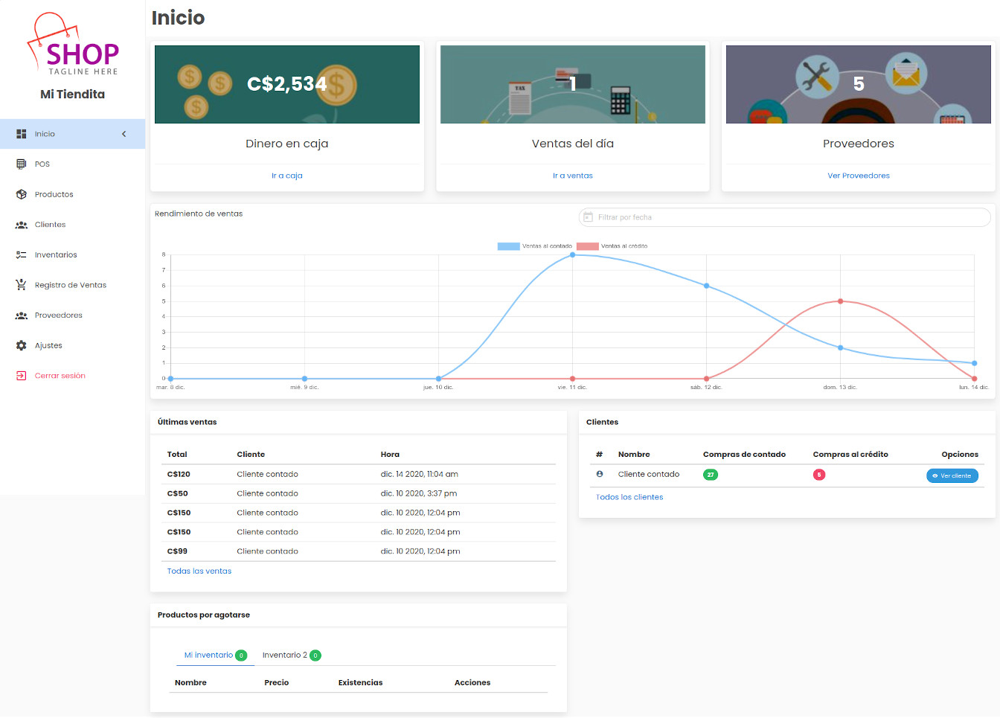
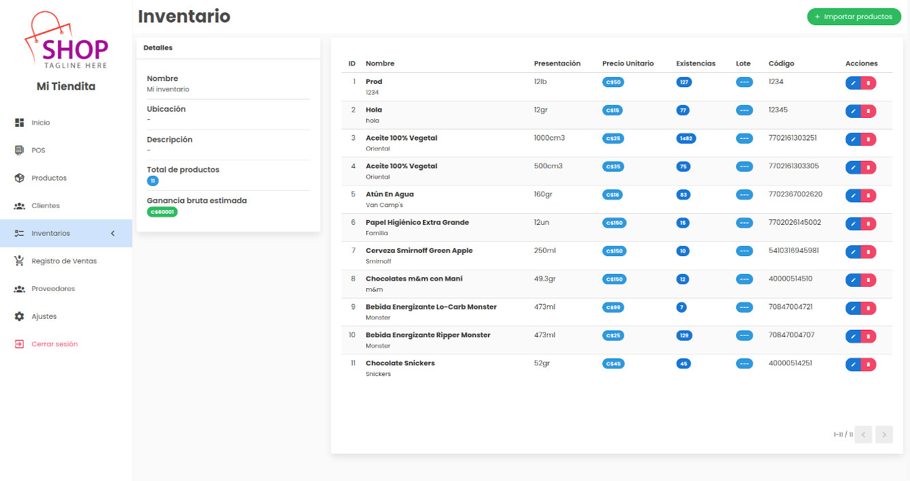
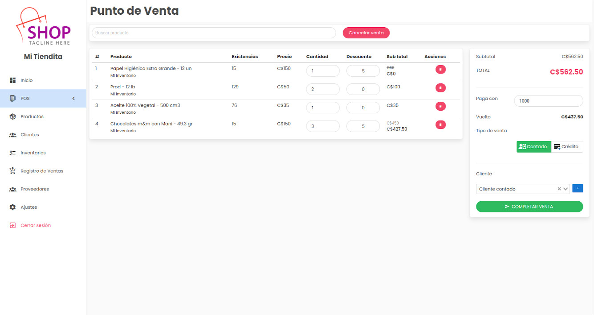

# ADM2

ADM2 is a web-first point-of-sale and inventory manager for small stores. It runs entirely
in the browser, stores data locally with IndexedDB, and works offline as a PWA.

> **Status.** `master` is the shipped v1 app described below. **v2** — a self-hosted
> server with a central database, multi-user access, and a LAN deployment — is in
> progress on the `v2` branch. Its plan, specs, and context live in `docs/`.

## Stack

| Layer | Technology |
|---|---|
| Framework | Vue 3.5 |
| Build | Vite 8 |
| UI | Buefy 3 / Bulma 1 |
| State | Pinia 4 + persisted state |
| Router | Vue Router 5 |
| i18n | Vue I18n 11 |
| Data | Dexie 4 (IndexedDB) |
| Charts | Chart.js 4 + vue-chartjs 5 |
| Dates | date-fns 4 |
| Forms | VeeValidate 4 |
| Tests | Vitest 5 + Playwright |
| Runtime | Node 26 LTS |

Desktop (Electron) and native (Capacitor) shells are intentionally out of scope for this
web-first version.

## Features

- Product, provider, and customer management
- Multiple inventories with stock, price, lot, and unlimited-stock support
- POS with barcode/search, cart, discounts, cash/credit sales, and customer credit
  (products must be added to an inventory before they appear in the POS)
- Receipt and invoice printing through the browser
- Sales history, partial/full refunds, and sales reports
- Cashbox with add/close/balance transactions, filters, and reports
- Dashboard with sales chart and low-stock alerts
- Local backups: export/import the full IndexedDB database as JSON
- Offline PWA with auto-updating service worker

## Requirements

- **Node 26 LTS** (`.nvmrc` is pinned to `26`)
- **Yarn 1.22.22**

Node 26 no longer ships Corepack, so install Yarn explicitly:

```bash
npm install -g yarn@1.22.22
```

## Setup

```bash
yarn install
yarn dev
```

Open the printed local URL. On first run the app asks you to create the store owner account.
Locale defaults live in `.env.example`; copy it to `.env` only if you need to override them.

## Scripts

| Command | Purpose |
|---|---|
| `yarn dev` | Vite dev server with HMR |
| `yarn build` | Production build into `dist/` |
| `yarn preview` | Serve the production build locally |
| `yarn test` | Vitest unit/DB tests |
| `yarn test:watch` | Vitest watch mode |
| `yarn test:e2e` | Start a preview server and run all Playwright suites |

The E2E runner uses the installed Google Chrome locally. CI sets
`PLAYWRIGHT_CHANNEL=bundled` and uses the Chromium installed by Playwright.

## Working with agents

v2 is built spec-first with a dedicated OpenCode agent so that every session produces the
same kind of change and `docs/plan/STATUS.md` is never stale.

### Before you start

- Work on the **`v2` branch**. `master` is the shipped v1 app and is not touched.
- The agent never pushes. Commits are local; pushing is a human decision.

### The agent

`adm2` is the repository default agent (`.opencode/opencode.jsonc`). It reads
`docs/plan/STATUS.md` first, implements **one** approved spec task at a time, writes tests
for the acceptance criteria, updates `STATUS.md`, and reports in a fixed format.

A read-only `spec-review` subagent checks a diff against its spec and `AGENTS.md`.

### Commands

| Command | What it does |
|---|---|
| `/start` | Cold start: reports the current phase, task, and next action. Changes nothing. |
| `/finish` | Runs the checks, updates `STATUS.md`, and reports with the standard format. |
| `/review [spec]` | Read-only review of the current diff against the spec. |
| `/spec <capability>` | Drafts or amends a spec. Never implements it. |

A normal session is:

```text
/start          → confirm the task
<work>          → implement, test
/review         → check against the spec
/finish         → checks, STATUS update, summary
```

### Reading order (same for humans and agents)

1. `docs/plan/STATUS.md` — where we are, what is next
2. `AGENTS.md` — repository rules that must not be broken
3. `docs/plan/roadmap.md` — phases and exit criteria
4. `docs/specs/00-conventions.md` — money, naming, API, immutability
5. The one spec for the task

Do not start coding before the spec is `approved`. If a rule is missing, ask — a missing
rule is a spec change, not a code decision.

### What lives where

| Path | Purpose |
|---|---|
| `AGENTS.md` | Rules every agent must follow |
| `docs/plan/` | Roadmap, status board, locked decisions |
| `docs/specs/` | One spec per capability, plus conventions |
| `docs/context/` | Market, fiscal, and currency background |
| `docs/adr/` | Decisions that are expensive to reverse |
| `.opencode/agents/` | `adm2` (primary) and `spec-review` (subagent) |
| `.opencode/commands/` | `/start`, `/finish`, `/review`, `/spec` |

## Architecture

```
src/
  controllers/   Dexie-backed data access (sales, customers, inventory, cashbox, users)
  db/            Dexie schema, class mappings, backup export/import
  store/         Pinia store with persistence
  lib/           money/date helpers, auth, validation, printing, serialization
  reports/       EJS invoice, receipt, sales, customer, and cashbox reports
  views/         Routed screens (POS, products, inventories, sales, cashbox, settings)
  components/    Feature components and shared UI
  locales/       i18n messages
```

The database name is `adm_2` and the schema must remain backward compatible with existing
installs. Local backups are JSON files exported with `dexie-export-import`.

## Testing

```bash
yarn test
yarn build
yarn test:e2e
```

The Playwright suites cover first-run registration, login/logout, backup export/import,
product/provider/customer CRUD, inventory bulk import and stock edits, POS cash/credit
sales, refunds, cashbox close/balance, dashboard/chart rendering, settings, PWA offline
mode, and keyboard/mobile flows.

## Deployment

Deploy the contents of `dist/` to any static host with SPA history fallback enabled
(`/index.html` for unknown paths). The generated service worker and manifest make the app
installable and offline-capable.

## Screenshots




