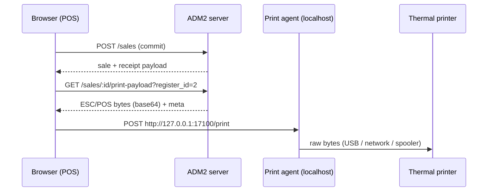

# Printing

> **Status: draft, Phase 5.** Nothing here blocks Phases 0–4. Until Phase 5 the app uses
> browser print with a dialog.

## 1. Purpose

Print receipts silently on the store's thermal printer, without a browser dialog, while
keeping a single web UI.

## 2. Why an agent and not a native app

A browser cannot suppress the print dialog reliably. The alternatives:

| Approach | Verdict |
|---|---|
| `--kiosk-printing` | Brittle; default printer only; fails silently; breaks on browser updates |
| Native shell (Tauri/Electron) | Second UI codebase, second release pipeline |
| **Local print agent** | One web UI, silent printing, ESC/POS features, optional per terminal |

## 3. Architecture



**The server renders the receipt; the agent only transports bytes.** Layout lives in one
place, and the agent stays dumb and replaceable.

## 4. Agent

- Runtime: **Node**, not Bun. Raw Windows spooler access uses native modules; keeping the
  agent on Node isolates that risk from the server.
- Distribution: separate binary/installer, one per POS machine. Optional.
- Binds to **`127.0.0.1` only** (never `0.0.0.0`).
- Default port `17100`, configurable on both sides.

### 4.1 Endpoints

| Method | Path | Auth | Purpose |
|---|---|---|---|
| `GET` | `/health` | none | `{ ok: true, version }` — used to detect the agent |
| `GET` | `/printers` | token | List printers the agent can see |
| `POST` | `/print` | token | Write a job |

### 4.2 Authentication

- Each register has an `agent_token` generated by the server (`register.write`).
- Every request except `/health` must carry `X-ADM2-Token`.
- The agent validates it against a locally configured token.
- Rationale: any website on that machine could otherwise print or kick the cash drawer.
- CORS: allow only the exact origins of the store server; reject everything else.

### 4.3 Print job

```json
{
  "printer": "EPSON TM-T20III",
  "format": "escpos",
  "width_mm": 80,
  "copy": 1,
  "open_drawer": true,
  "payload_base64": "G0Ah..."
}
```

- `format`: `escpos` (v1) or `raw` (pass-through bytes).
- The agent never interprets the content. It writes bytes and, when asked, sends the drawer
  kick after the job.
- Errors return `{ ok: false, code, message }`; the browser shows a Spanish message and
  offers browser print.

## 5. Receipt rendering (server side)

- Character width: **32 columns for 58 mm**, **48 for 80 mm**, from the register config.
- Supported features: bold, double height/width, alignment, line separators, cut (`GS V`),
  drawer kick (`ESC p 0 25 250`).
- Content rules come from `fiscal.md` §6.
- Renderer is deterministic: the same sale + snapshot produces identical bytes.

Endpoint: `GET /api/v1/sales/:id/print-payload?register_id=:id` (`sale.read.*` scope).
Returns bytes as base64 plus `width_mm`, `open_drawer`, and `printer_hint`.

## 6. Fallback

| Situation | Behaviour |
|---|---|
| Agent absent (`/health` fails) | Browser print, with a one-time toast explaining it |
| Agent present, printer offline | Agent error → browser print offer |
| Auto-print disabled in settings | Show the receipt preview; the cashier prints explicitly |
| Browser print used | Receipt is the HTML version, same content |

## 7. Register configuration

```
register.printer_config = {
  "mode": "escpos",
  "printer": "EPSON TM-T20III",
  "width_mm": 80,
  "open_drawer": true,
  "agent_port": 17100
}
```

- Configured per register in admin settings.
- "Test print" button triggers a sample job through the agent.
- Misconfiguration must never block a sale: printing failures are non-fatal.

## 8. Mixed content note

If the store server is served over HTTPS, the browser calls `http://127.0.0.1`. Browsers
treat loopback as a trustworthy origin, but this must be verified on the target Chrome
version during Phase 5. On plain HTTP LAN deployments it is not an issue.

## 9. Edge cases

| Case | Behaviour |
|---|---|
| Agent running but wrong token | `401`; the app offers browser print |
| Two agents on one machine | Port conflict at startup; the agent refuses to start |
| Printer out of paper | Agent reports the error; the sale still completes |
| Drawer kick requested without a drawer | Bytes are sent; the printer ignores them |
| Reprint of an old sale | Uses the snapshot; same content as the original |
| Server unreachable | The sale cannot complete, so there is nothing to print |

## 10. Acceptance criteria

- **AC-1** With the agent running, a sale prints with no browser dialog.
- **AC-2** Paper cut and drawer kick work on the reference printer (80 mm).
- **AC-3** With the agent absent, the app falls back to browser print and says so.
- **AC-4** A request with a wrong token returns 401 and prints nothing.
- **AC-5** The agent refuses to bind to anything other than `127.0.0.1`.
- **AC-6** A failed print never prevents the sale from being committed.

## 11. Non-goals

- Printing reports (A4) — those use browser print.
- Cloud printing or print queues.
- Multiple printers per register.
- Fiscal printer (IFiscal) integration.
- Printing from the server (the server may not be near the printer).
