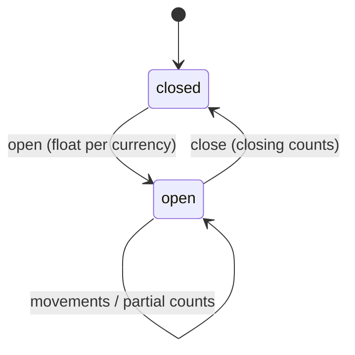

# Registers and cash sessions

## 1. Purpose

Model the physical reality of a store: **a drawer belongs to a terminal**, and several
people may use it during one session. Also define how cash is counted, reconciled, and
closed.

## 2. Concepts

```text
user      who performed an action        (attribution)
register  a terminal and its drawer      (device identity)
session   a drawer period: float -> movements -> counts -> close
```

**The drawer is not owned by a cashier.** Every sale, movement, and count is attributed to
a user, but the session belongs to the register. Two cashiers can use one drawer in the
same session.

## 3. Register identity

- A `register` has a name, a unique code, active flag, and (Phase 5) printer config.
- The browser stores the selected `register_id` in `localStorage` under `adm2.register_id`.
  This is **not** authentication data; clearing it only requires re-selecting the register.
- On login the terminal may send `register_id`; the server validates that the register
  exists and is active, and records it on the auth session.
- A terminal with no selected register is prompted to choose one before opening a cash
  session.
- Registers are created and edited by an admin (`register.write`). They are **never
  deleted** if they have any sales or sessions; they are deactivated.

## 4. Session lifecycle



| Transition | Who | Precondition |
|---|---|---|
| open | `cash.open` | No other open session on this register; floats provided |
| movement | `cash.count` | Session open |
| partial count | `cash.count` | Session open |
| close | `cash.close` (or `cash.close.other`) | Session open; closing counts supplied |

**Invariant:** at most one open session per register. Enforced by a partial unique index:

```sql
CREATE UNIQUE INDEX ux_cash_session_open
  ON cash_session(register_id) WHERE closed_at IS NULL;
```

## 5. Money in the drawer

### 5.1 Opening float

Declared per currency at open:

```json
{ "register_id": 2, "floats": [{ "currency": "NIO", "amount_minor": 100000 }] }
```

A currency with no float is treated as `0`. Floats are stored in
`cash_session_float` and are immutable.

### 5.2 Movements

Every cash change during the session is a row. **Positive = into the drawer.**

| `type` | Sign | Source |
|---|---|---|
| `sale` | + | Auto, from a cash sale (per currency tendered) |
| `change` | − | Auto, change returned in NIO |
| `refund` | − | Auto, from a cash refund |
| `credit_payment` | + | Auto, from a customer paying down credit |
| `deposit` | + | Manual: extra float / cash added |
| `withdrawal` | − | Manual: retiro to the safe |
| `adjustment` | ± | Manual correction, requires a note |

Rules:

- `sale`, `change`, and `refund` movements are created **inside the sale/refund
  transaction**, never by the client.
- Manual movements require `cash.count`, a note, and write an audit row.
- A sale paid in USD with change in NIO produces **two** movements: `+USD` and `−NIO`.
- Movements are append-only. A mistake is corrected with another movement, not an edit.

### 5.3 Expected balance

```
expected(currency) = opening float(currency)
                   + Σ movements up to the count timestamp
```

Computed **server-side only**. The client never sends an expected value.

## 6. Counts

### 6.1 Kinds

| Kind | When | Effect |
|---|---|---|
| `partial` | handover, suspicion, mid-day "corte" | Snapshot only; session stays open |
| `closing` | end of session | Snapshot **and** closes the session |

Opening floats are **not** counts; they are the seed of the ledger.

### 6.2 Blind counting

- `settings.blind_counts` defaults to `1`.
- When blind, neither the response to the count request nor the UI shows `expected` before
  the cashier submits `counted`.
- After submission, the difference is shown.
- Admin screens always show expected, counted, and difference.

### 6.3 Recording a count

```json
POST /cash-sessions/:id/counts
{ "kind": "partial", "currency": "NIO", "counted_minor": 1245000, "note": "cambio de turno" }
```

The server:

1. Computes `expected` at that instant.
2. Stores `expected_minor`, `counted_minor`, `difference_minor = counted − expected`.
3. Records `counted_by` and `counted_at`.
4. **Does not modify** the ledger or the expected balance.

A partial count is a checkpoint, not an adjustment. If cash is physically added or removed
because of the count, that is a separate `deposit`/`withdrawal` movement.

### 6.4 Differences

- Differences are **register-level**, because the drawer is shared.
- They are never edited. An admin may attach a note (`annotation`) to a count.
- The difference between two consecutive counts belongs to that interval, which gives
  per-cashier attribution without per-cashier sessions:

```
interval 08:00–14:00 (Ana)
  sales by Ana        C$12,400
  expected            C$13,000
  counted             C$12,950
  difference          −C$50
```

- A difference larger than `settings.cash_difference_alert_minor` (default `C$100.00`,
  `10000`) is flagged on the admin dashboard. Closing is never blocked.

## 7. Closing

- **Any cashier may close any drawer**, including one another cashier opened
  (`cash.close.other` for cashiers as decided).
- If another user has an **active auth session bound to this register**, the request
  returns `409 register_in_use` unless `force: true` is sent; forcing is audited.
- Closing requires a `closing` count for **every currency with activity** in the session.
  Zero is a valid counted value; omitting a currency with activity is `422 missing_count`.
- Closing sets `status = 'closed'`, `closed_at`, `closed_by`.
- Closing does not require an admin and does not block on a difference.

## 8. API

| Method | Path | Permission | Purpose |
|---|---|---|---|
| `GET` | `/registers` | `product.read` | List active registers |
| `POST` | `/registers` | `register.write` | Create |
| `PATCH` | `/registers/:id` | `register.write` | Rename / deactivate / printer config |
| `GET` | `/cash-sessions` | `cash.count` | Filter by `register_id`, `status` |
| `POST` | `/cash-sessions` | `cash.open` | Open with floats |
| `GET` | `/cash-sessions/:id` | `cash.count` | Session + movements + counts |
| `POST` | `/cash-sessions/:id/movements` | `cash.count` | Manual movement |
| `POST` | `/cash-sessions/:id/counts` | `cash.count` | Partial count |
| `POST` | `/cash-sessions/:id/close` | `cash.close` | Closing counts + close |
| `GET` | `/cash-sessions/:id/summary` | `cash.count` | Expected per currency, per-user sales |

### `GET /cash-sessions/:id/summary`

```json
{
  "session": { "id": 8, "register_id": 2, "status": "open", "opened_at": "..." },
  "balances": [
    { "currency": "NIO", "opening_minor": 100000, "movements_minor": 1240000,
      "expected_minor": 1340000 },
    { "currency": "USD", "opening_minor": 0, "movements_minor": 2000,
      "expected_minor": 2000 }
  ],
  "by_user": [
    { "user_id": 3, "name": "Ana", "sales_minor": 1240000, "sales_count": 41 }
  ],
  "counts": [
    { "id": 5, "kind": "partial", "currency": "NIO", "counted_minor": 1245000,
      "difference_minor": -500, "counted_by": 3, "counted_at": "..." }
  ]
}
```

## 9. Data model

### `register`

`id`, `name`, `code` (unique), `active` (0/1), `printer_config` (JSON null),
`created_at`, `updated_at`.

### `cash_session`

`id`, `register_id` FK, `status` (`open`|`closed`), `opened_by` FK, `opened_at`,
`closed_by` FK null, `closed_at` null, `notes` null, `created_at`, `updated_at`.

### `cash_session_float`

`id`, `cash_session_id` FK, `currency`, `amount_minor`, `created_at`.
Unique `(cash_session_id, currency)`.

### `cash_movement`

`id`, `cash_session_id` FK, `type`, `currency`, `amount_minor` (signed), `reference_type`
null, `reference_id` null, `user_id` FK, `notes` null, `created_at`.

### `cash_count`

`id`, `cash_session_id` FK, `kind` (`partial`|`closing`), `currency`, `expected_minor`,
`counted_minor`, `difference_minor`, `counted_by` FK, `counted_at`, `note` null,
`annotation` null, `annotated_by` null, `annotated_at` null.

## 10. Edge cases

| Case | Behaviour |
|---|---|
| Open a second session on a register | `409 session_already_open` |
| Sell with no open session | `409 cash_session_required` |
| Manual movement of zero | `422 invalid_amount` |
| Count in a currency with no float or movements | Allowed; expected is `0` |
| Count submitted twice by a double click | Second is a separate count (both recorded) |
| Close while another cashier is logged in on the register | `409 register_in_use` unless `force: true` |
| Close omitting a currency with activity | `422 missing_count` |
| Session open more than 24 h | Not blocked; flagged `open_too_long` for the dashboard |
| Register deactivated with an open session | Allowed; the session can still be closed |
| Cash refund larger than the drawer | Allowed; the drawer may go negative; flagged on close |

## 11. Acceptance criteria

- **AC-1** Two terminals cannot open a session on the same register; the second gets 409.
- **AC-2** A cash sale creates `sale` and `change` movements in the right currencies and
  the expected balance matches the arithmetic.
- **AC-3** A partial count never changes the expected balance.
- **AC-4** Closing without counts for an active currency returns 422.
- **AC-5** Closing sets `status = closed` and rejects further movements with 409.
- **AC-6** With `blind_counts = 1`, the count response omits `expected_minor` and
  `difference_minor`; with `0`, it includes them.
- **AC-7** Two consecutive counts produce an interval with correct per-user sales totals.
- **AC-8** Closing a register with another active auth session returns 409 unless forced,
  and forcing writes an audit row.
- **AC-9** USD and NIO balances reconcile independently.

## 12. Non-goals

- Cashier-owned drawers (one drawer per person).
- Automatic session rollover at midnight.
- Denominations/bill breakdown in counts (totals per currency only).
- Bank deposit tracking or safe management.
- Cash transfer between registers.
