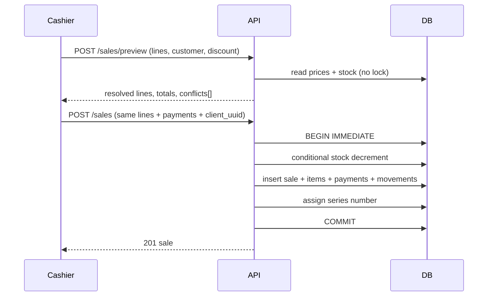

# Sales

## 1. Purpose

Turn a cart into one atomic, numbered, auditable sale — correctly, under concurrency, and
with the server as the only authority on stock, price, and totals.

## 2. Actors

| Actor | Can do |
|---|---|
| Cashier | Preview, commit, read own sales |
| Admin | All of the above, read all sales, void |

## 3. Principles

1. **The client is never trusted** for prices, totals, tax, stock, or availability.
2. **Preview is advisory.** It reads and reports; it never reserves.
3. **Commit is the only decision.** It happens in one `BEGIN IMMEDIATE` transaction.
4. **A sale is append-only.** It is voided by a controlled status change plus reversal
   rows; it is never edited.

## 4. Cart lifecycle



## 5. Preview

`POST /api/v1/sales/preview`

```json
{
  "register_id": 2,
  "sale_type": "cash",
  "customer_id": null,
  "lines": [
    { "product_id": 42, "quantity_milli": 2000 },
    { "product_id": 77, "inventory_product_id": 15, "quantity_milli": 1000 }
  ],
  "discount": { "kind": "percent", "value": 1000 },
  "coupon_id": null
}
```

Response `200`:

```json
{
  "lines": [
    { "product_id": 42, "name": "Pantalla 6.1\"", "kind": "goods",
      "quantity_milli": 2000, "available_milli": 1000,
      "unit_price_minor": 120000, "price_changed": false, "conflict": true },
    { "product_id": 77, "name": "Reparación", "kind": "service",
      "quantity_milli": 1000, "available_milli": null,
      "unit_price_minor": 80000, "price_changed": false, "conflict": false }
  ],
  "totals": {
    "subtotal_minor": 320000,
    "discount_minor": 32000,
    "tax_minor": 43200,
    "total_minor": 331200
  },
  "conflicts": [
    { "product_id": 42, "requested_milli": 2000, "available_milli": 1000,
      "reason": "insufficient_stock" }
  ],
  "cash_rounding": { "mode": "nearest_50", "rounded_total_minor": 331200,
                     "rounding_minor": 0 }
}
```

Rules:

- Prices come from the database, resolved for the register's store and inventory.
- `price_changed` is set when the client sent a `expected_unit_price_minor` that differs.
- Services have `available_milli = null` and never conflict on stock.
- Preview performs **no writes** and takes **no locks**.

## 6. Commit

`POST /api/v1/sales`

Adds to the preview body:

```json
{
  "client_uuid": "6f1c…",
  "payments": [ { "method": "cash", "currency": "NIO", "tendered_minor": 400000 } ],
  "accept_rounding": true,
  "approval_token": null
}
```

### 6.1 Transaction order (strict)

1. **Idempotency.** If `sale.client_uuid` already exists → return the original sale with
   `200`, no writes.
2. **Session.** Resolve the open `cash_session` for `register_id`; missing →
   `409 cash_session_required`.
3. **Resolve lines** from the database: product, kind, unit price, tax rate. Reject
   unknown/soft-deleted products with `422 product_unavailable`.
4. **Discount cap.** If the discount exceeds the caller's cap and no valid
   `approval_token` is present → `403 cap_exceeded`.
5. **Stock.** For each `goods` line with tracked stock:
   ```sql
   UPDATE inventory_product
      SET stock_milli = stock_milli - :qty
    WHERE id = :id AND stock_milli >= :qty;
   ```
   Zero rows changed → rollback, `409 stock_conflict` with `details.lines`.
   `unlimited_stock` and services skip this step.
6. **Totals.** Computed server-side (§7).
7. **Payments.** Validate coverage and compute change (§8).
8. **Number.** Assign from `document_series` (§9).
9. **Insert** `sale`, `sale_item`, `payment`; write `stock_movement` per goods line;
   write `cash_movement` per cash tender and change; update the customer's credit ledger
   (credit sales).
10. **Audit.** One row.
11. **Commit.**

Any failure rolls back everything: no partial sale, no stock change, no movement.

### 6.2 Response `201`

```json
{
  "sale": {
    "id": 1042, "number": "A-0001042", "series": "A",
    "sale_type": "cash", "status": "completed",
    "subtotal_minor": 320000, "discount_minor": 32000,
    "tax_minor": 43200, "rounding_minor": 0, "total_minor": 331200,
    "change_minor": 68800, "created_at": "2026-11-20T18:22:10.000Z"
  },
  "receipt": { "...": "render payload, server-rendered" }
}
```

## 7. Money rules

### 7.1 Line arithmetic

```
line_gross_minor  = round_half_up(unit_price_minor × quantity_milli / 1000)
line_discount_minor = line discount + allocated share of sale discount
line_net_minor    = line_gross_minor − line_discount_minor
line_tax_minor    = round_half_up(line_net_minor × tax_rate_bp / 10000)
line_total_minor  = line_net_minor + line_tax_minor
```

### 7.2 Sale-level discount allocation

A sale-level discount (manual or coupon) is allocated **pro rata** to lines by
`line_gross_minor` **before** tax, so the tax base is reduced:

```
share_i = floor(discount_minor × gross_i / subtotal_minor)
```

The rounding remainder goes to the line with the largest gross (ties → lowest `id`), so the
allocated amounts sum exactly to the discount.

### 7.3 Totals

```
subtotal_minor = Σ line_gross_minor
discount_minor = Σ line_discount_minor
tax_minor      = Σ line_tax_minor
total_minor    = subtotal_minor − discount_minor + tax_minor
```

Invariant: `total_minor = Σ line_total_minor`. Violation is a `500`, never a silent
mismatch.

### 7.4 Configuration snapshot

Every sale stores an immutable `config_snapshot`:

```json
{
  "accounting_currency": "NIO",
  "exchange_rate": { "rate_micro": 36624300, "effective_date": "2026-11-20", "source": "bcn" },
  "fiscal": { "regime": "general", "series_code": "A" },
  "rounding": { "mode": "nearest_50", "currency": "NIO" },
  "tax": { "default_rate_bp": 1500 }
}
```

Reprints, refunds, and reports read the snapshot and the stored line snapshots — never the
current settings. A sale must remain explainable after any configuration change.

## 8. Payments

v2 supports **cash only**. `card` and `transfer` are reserved values and are rejected with
`422 unsupported_payment_method` until implemented.

### 8.1 Tender and change

```
tendered_base_minor = round_half_up(tendered_minor × rate_micro / 1_000_000)   // NIO
amount_due_minor    = total_minor + rounding_minor
change_minor        = Σ tendered_base_minor − amount_due_minor
```

- `change_minor` must be ≥ 0, else `422 insufficient_payment`.
- Change is returned in **NIO** in v2.
- Each cash tender creates a `cash_movement` `+amount` in its own currency.
- Change creates a `cash_movement` `−change_minor` in NIO.

### 8.2 Rounding

- Applies only when `sale_type = 'cash'` and the store's `cash_rounding_mode != 'none'`.
- `rounding_minor = rounded_due − total_minor` (signed), computed on the **cash amount
  due**, never on the tax base and never on a credit sale.
- Modes: `none`, `down`, `nearest_50`, `nearest_100` (in minor units).
- If `rounding_minor != 0`, the client must send `accept_rounding: true`; otherwise
  `422 rounding_not_accepted`.
- The receipt shows `Total`, `Redondeo`, and the cash amount.

### 8.3 Credit sales

- `sale_type = 'credit'` requires a `customer_id`.
- `payments` must be empty; `422 credit_cannot_tender`.
- Rounding does not apply.
- The customer's derived balance increases by `total_minor` (see `customers-credit.md`).

## 9. Numbering

```sql
UPDATE document_series
   SET next_number = next_number + 1
 WHERE id = :id
RETURNING next_number - 1 AS number;
```

- Happens **inside** the sale transaction, so numbers are gapless per store.
- A rolled-back sale does not consume a number.
- Format: `{prefix}-{number padded to 7}` e.g. `A-0001042`.
- Numbers are never reused and never renumbered.

## 10. Void

`POST /api/v1/sales/:id/void` — `sale.void`, admin only, reason required.

Allowed only when:

- `status = 'completed'`, and
- the sale's `cash_session` is **still open** (same shift).

Otherwise `409 use_refund` — a sale from a closed session is corrected with a refund,
never a void.

A void, in one transaction:

1. Writes reversal `stock_movement` rows for goods lines.
2. Writes reversal `cash_movement` rows.
3. Reverses the credit ledger entry.
4. Sets `status = 'voided'`, `voided_at`, `voided_by`, `void_reason` (the only permitted
   mutation of a sale).
5. Writes an audit row.

## 11. Reads

| Method | Path | Permission | Purpose |
|---|---|---|---|
| `GET` | `/sales` | `sale.read.own` / `sale.read.all` | Filters: `from`, `to`, `user_id`, `register_id`, `sale_type`, `status`, `q`, paginated |
| `GET` | `/sales/:id` | as above | Detail with lines and payments |
| `GET` | `/sales/:id/receipt` | as above | Render payload for reprint |

Scope rule: `sale.read.own` returns only sales where `user_id = me`. Admin sees all.

## 12. Data model

### `sale`

`id`, `series_id` FK, `number` integer, `number_label` text, `register_id` FK,
`cash_session_id` FK, `user_id` FK, `customer_id` FK null, `sale_type` (`cash`|`credit`),
`status` (`completed`|`voided`), `subtotal_minor`, `discount_minor`, `tax_minor`,
`rounding_minor`, `total_minor`, `change_minor`, `currency` (`NIO`), `rate_micro`,
`rate_source`, `rate_effective_date`, `client_uuid` (unique), `config_snapshot` JSON,
`created_at`, `voided_at` null, `voided_by` null, `void_reason` null, `updated_at`.

### `sale_item`

`id`, `sale_id` FK, `product_id` FK, `inventory_product_id` FK null, `kind`
(`goods`|`service`), `name` (snapshot), `quantity_milli`, `unit_price_minor`,
`line_gross_minor`, `discount_minor`, `line_net_minor`, `tax_rate_bp`, `tax_minor`,
`line_total_minor`.

Snapshots (`name`, prices, rate, kind) make reprints and reports independent of later
catalogue edits.

### `payment`

`id`, `sale_id` FK, `method` (`cash`), `currency`, `tendered_minor`, `rate_micro`,
`tendered_base_minor`, `created_at`.

## 13. Edge cases

| Case | Behaviour |
|---|---|
| Two terminals sell the last unit | One `201`, one `409 stock_conflict` |
| Retry after a timeout with the same `client_uuid` | `200` with the original sale, no duplicate |
| Same `client_uuid`, different body | `409 idempotency_mismatch` |
| Price changed between preview and commit | Server price wins; the response marks `price_changed` |
| Product deleted while in a cart | `422 product_unavailable` |
| Empty cart | `422 empty_sale` |
| Quantity zero or negative | `422 invalid_quantity` |
| Service quantity fractional (hours) | Allowed (e.g. `500` = 0.5 h) |
| Sale total of zero (100% discount) | Rejected unless an approval token is present |
| Rounding not accepted by the client | `422 rounding_not_accepted` |
| Cash drawer was closed between preview and commit | `409 cash_session_required` |
| Credit sale without a customer | `422 customer_required` |
| Void of a sale from a closed session | `409 use_refund` |

## 14. Acceptance criteria

- **AC-1** Two independent clients committing the last unit produce exactly one `201` and
  one `409`, and stock ends at zero.
- **AC-2** A duplicate `client_uuid` returns the original sale and creates no second
  `cash_movement`.
- **AC-3** Totals are computed from server prices even when the client sends different
  prices.
- **AC-4** Sale-level discounts reduce the tax base: the sum of line taxes equals the tax
  of the discounted lines.
- **AC-5** A cash sale with a USD tender produces `+USD` and `−NIO` movements and the
  drawer balances.
- **AC-6** Rounding changes only `rounding_minor` and the cash due; `total_minor` stays
  exact.
- **AC-7** A credit sale creates no cash movement and increases the customer balance by the
  exact total.
- **AC-8** Numbers are gapless: 100 consecutive sales produce 100 consecutive numbers, and
  a rolled-back sale consumes none.
- **AC-9** A sale line keeps its price and tax after the product's price or tax changes.
- **AC-10** `sale.read.own` cannot return another cashier's sale.
- **AC-11** A void from an open session restores stock and cash; a void from a closed
  session returns `409 use_refund`.

## 15. Non-goals

- Quotes, layaway, or pending sales.
- Card, transfer, or mixed card/cash payments.
- Splitting one cart into multiple sales (and vice versa).
- Returns of undelivered goods, delivery status, or order tracking.
- Customer-facing screens or self-checkout.
- Reservations or stock holds.
- Offline queuing.
- Reprinting with different content than the original snapshot.
